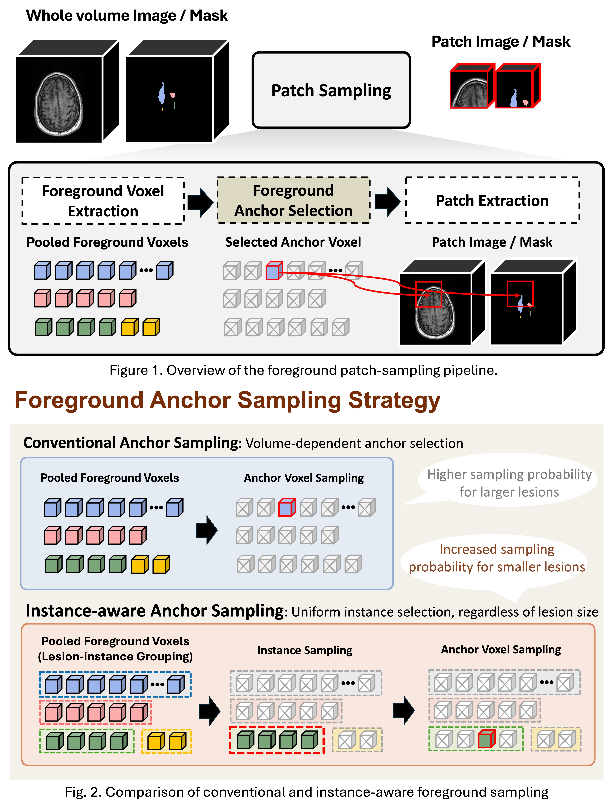
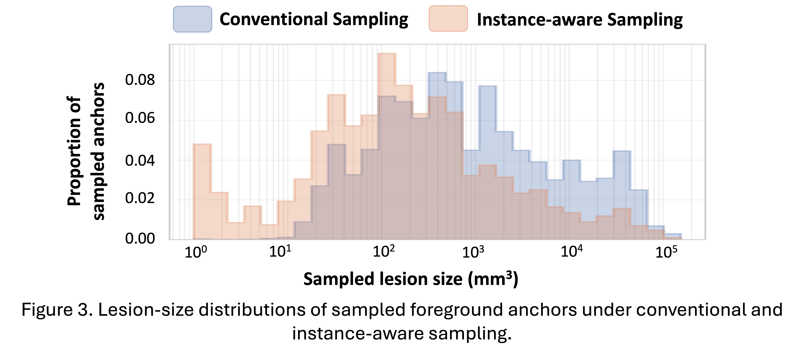
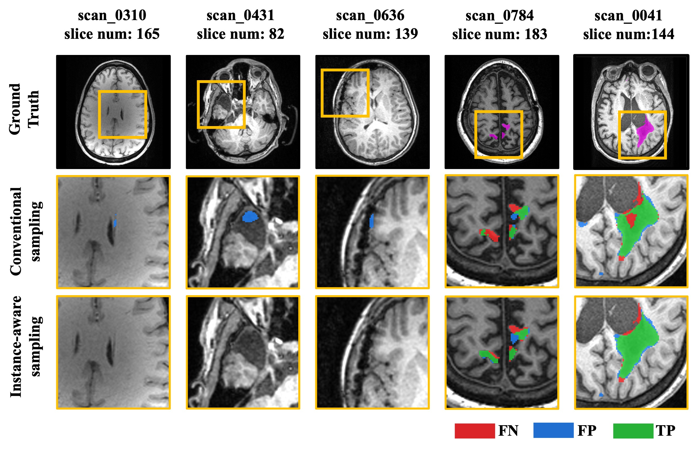

# AIMSTBI26_QuIIL_DeepClue

Team **QuIIL-DeepClue**'s submission to the [AIMS-TBI 2026 challenge](https://aims-tbi26.grand-challenge.org/), built on [nnU-Net v2](https://github.com/MIC-DKFZ/nnUNet).




## Challenge

Automated Identification of Mod-Sev TBI Lesions (AIMS-TBI'26) targets the detection and segmentation of lesions in T1-weighted MRI from moderate-to-severe traumatic brain injury (msTBI), covering contusions, hemorrhage, hematoma, encephalomalacia, gliosis, white matter lesions, and surgical drainage tracts.

**Inputs**

- Native-space T1w MRI
- Tabular demographic and clinical data

**Output**

- Binary TBI lesion segmentation mask

## Method

| Component | Setting |
| --- | --- |
| Architecture | Residual Encoder U-Net (ResEnc M) |
| Configuration | `3d_fullres` |
| Patch size | 128 × 128 × 128 |
| Batch size | 8 |
| Sampling | Instance-aware lesion sampling |
| Loss | 0.3 · CE + 0.4 · Dice + 0.3 · Focal |
| Inference | 5-fold ensemble |

- Trainer: `nnUNetTrainerInstanceAwareSampling_03CE04Dice03FocalLoss`
- Plans: `nnUNetResEncUNetMpatch128_InstanceSampling_Batch8_Plans`

## Installation

Set up a Python environment with the nnU-Net dependencies, then install the modified nnU-Net source bundled in this repository.

```bash
pip install -e nnUNet
```

## Usage

### 0. Environment variables

```bash
export nnUNet_raw="DATA/nnUNet_raw"
export nnUNet_preprocessed="DATA/nnUNet_preprocessed"
export nnUNet_results="nnUNet_results"

export OPENBLAS_NUM_THREADS=1
export OMP_NUM_THREADS=1
export MKL_NUM_THREADS=1
export NUMEXPR_NUM_THREADS=1
```

### 1. Dataset preparation

Arrange the challenge data under `$nnUNet_raw` following the nnU-Net v2 raw format:

```
DATA/nnUNet_raw/Dataset<DATASET_ID>_AIMSTBI/
├── dataset.json
├── imagesTr/
│   ├── <case_id>_0000.nii.gz
│   └── ...
└── labelsTr/
    ├── <case_id>.nii.gz
    └── ...
```

### 2. Planning and preprocessing

Extract the dataset fingerprint and generate the baseline ResEnc plans:

```bash
nnUNetv2_extract_fingerprint -d <DATASET_ID>
nnUNetv2_plan_experiment -d <DATASET_ID> -pl nnUNetPlannerResEncM
```

Copy the generated `nnUNetResEncUNetMPlans.json` to `nnUNetResEncUNetMpatch128_InstanceSampling_Batch8_Plans.json` and edit the following fields:

| Field | Value |
| --- | --- |
| `plans_name` | `nnUNetResEncUNetMpatch128_InstanceSampling_Batch8_Plans` |
| `configurations.3d_fullres.data_identifier` | `nnUNet_wInstanceLocationPlans_3d_fullres` |
| `configurations.3d_fullres.preprocessor_name` | `wInstanceLocationPreprocessor` |
| `configurations.3d_fullres.batch_size` | `8` |
| `configurations.3d_fullres.patch_size` | `[128, 128, 128]` |

The custom preprocessor stores lesion instance locations alongside the preprocessed volumes, which the instance-aware sampler uses during training.

Run preprocessing with the modified plans:

```bash
nnUNetv2_preprocess -d <DATASET_ID> \
  -plans_name nnUNetResEncUNetMpatch128_InstanceSampling_Batch8_Plans \
  -c 3d_fullres
```

### 3. Training

Train all five folds. Prefix with `nnUNet_wandb_enabled=1` to log to Weights & Biases.

```bash
for FOLD in 0 1 2 3 4; do
  nnUNetv2_train <DATASET_ID> 3d_fullres $FOLD \
    -p nnUNetResEncUNetMpatch128_InstanceSampling_Batch8_Plans \
    -tr nnUNetTrainerInstanceAwareSampling_03CE04Dice03FocalLoss
done
```

### 4. Inference

Per-fold prediction:

```bash
nnUNetv2_predict \
  -d <DATASET_ID> \
  -i <input_images_dir> \
  -o <fold_pred_dir> \
  -f <FOLD> \
  -c 3d_fullres \
  -p nnUNetResEncUNetMpatch128_InstanceSampling_Batch8_Plans \
  -tr nnUNetTrainerInstanceAwareSampling_03CE04Dice03FocalLoss \
  --save_probabilities
```

5-fold ensemble (final submission):

```bash
nnUNetv2_predict \
  -d <DATASET_ID> \
  -i <input_images_dir> \
  -o <ensemble_pred_dir> \
  -f 0 1 2 3 4 \
  -c 3d_fullres \
  -p nnUNetResEncUNetMpatch128_InstanceSampling_Batch8_Plans \
  -tr nnUNetTrainerInstanceAwareSampling_03CE04Dice03FocalLoss
```

### 5. Evaluation

Case-level Dice, HD95, and ASSD:

```bash
python test.py --pred_dir <pred_dir> --gt_dir DATA/nnUNet_raw/Dataset<DATASET_ID>_AIMSTBI/labelsTr
```


## Acknowledgements

This work builds on [nnU-Net](https://github.com/MIC-DKFZ/nnUNet) by MIC-DKFZ. Data is provided by the [AIMS-TBI challenge](https://github.com/adionicas/AIMS-TBI-challenge) organizers through the ENIGMA Consortium TBI working group.